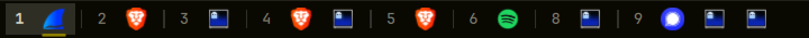

# Workspace Taskbar

A slim taskbar along the bottom of the screen for [Omarchy](https://omarchy.org)
that shows **every open window on every workspace**, grouped by workspace.
Click an icon to jump straight to that window, wherever it is.

It's meant for anyone who loses track of what is open in a tiling window
manager:



- Each workspace that has windows gets a small group: its number, then one
  icon per window.
- The workspace you're on is tinted, and the focused window is underlined.
  A window asking for attention is underlined in the urgent color.
- Special workspaces such as the scratchpad come after the regular ones
  (`S:name`). Minimized windows come last (`–`).
- The bar is about 26px tall and shows icons only. Hover an icon to see the
  window title, the app, and its workspace.

## Install

```sh
omarchy plugin add https://github.com/slinn-01/omarchy-taskbar --enable
```

Or, from a local checkout:

```sh
scripts/dev-sync.sh --enable
```

## Turn it on and off

The plugin is a self-contained shell service, so enabling or disabling it
leaves the rest of the desktop untouched:

```sh
omarchy plugin disable io.github.slinn-01.taskbar   # gone, windows get the space back
omarchy plugin enable  io.github.slinn-01.taskbar   # back again
```

## Remove

```sh
omarchy plugin disable io.github.slinn-01.taskbar
omarchy plugin remove io.github.slinn-01.taskbar
```

This deletes only the plugin's own folder under `~/.config/omarchy/plugins/`
and its entry in `shell.json`. No other configuration is touched; the
plugin never writes to your config, and it keeps no state or cache files.

## Dependencies

There are no extra packages. The plugin uses only the following, which an
Omarchy system already has:

- Omarchy Quattro's shell plugin system (`omarchy-shell`, Quickshell)
- Hyprland
- `hyprctl` and `bash`, to run Hyprland dispatches

It does not use the network.

## Hide and show

Hide or show it for the current session:

```sh
omarchy-shell io.github.slinn-01.taskbar toggle   # also: show, hide, status
```

To bind that to a key, add this line to `~/.config/hypr/bindings.lua`.
Super + Shift + Alt + Space is unused by default; Super + Shift + Space
already toggles the top bar.

```lua
o.bind("SUPER + SHIFT + ALT + SPACE", "Toggle taskbar", "omarchy-shell io.github.slinn-01.taskbar toggle")
```

The taskbar also gets out of the way on its own while a window is
fullscreen.

## Mouse

| Action | Result |
|---|---|
| Click an icon | Focus that window and switch to its workspace. A minimized window is restored onto the workspace you're looking at. |
| Middle-click an icon | Close that window. |
| Click a workspace number | Switch to that workspace. |
| Scroll | Scroll the bar sideways when it overflows. |

## Settings

Settings are extra keys on the plugin's entry in
`~/.config/omarchy/shell.json`. They apply as soon as you save.

```json
"plugins": [
  { "id": "io.github.slinn-01.taskbar", "autohide": true, "iconSize": 18 }
]
```

| Key | Default | Meaning |
|---|---|---|
| `autohide` | `false` | Keep the bar tucked away until the pointer touches the bottom edge. Tiled windows then use the full height. |
| `allMonitors` | `false` | With several monitors, show every monitor's windows on every bar. Other monitors' workspaces are labeled with their monitor, e.g. `2·HDMI-A-1`. By default each bar shows only its own monitor's windows. |
| `iconSize` | `16` | Icon size in pixels, from 12 to 24. The bar's height follows it. |

Running `omarchy plugin disable` removes the entry, settings included.

## Scripting

`omarchy-shell io.github.slinn-01.taskbar windows` prints, as JSON, what
each screen's bar is currently listing.

## Notes

- Multi-monitor support follows Omarchy's per-monitor workspaces: each
  monitor numbers its own workspaces 1–10. It is covered by unit tests but
  has only been tried live on a single display.
- If you move Omarchy's main bar to the bottom, the taskbar sits just above
  it.
- Windows opened as a web app without a desktop entry show their browser's
  icon.

## Development

```sh
node --test tests/                     # model unit tests
omarchy plugin validate .              # manifest check
scripts/dev-sync.sh --enable        # copy into ~/.config/omarchy/plugins and enable
scripts/dev-sync.sh --restart       # update an installed copy, then restart the shell
```

When the shell hot-reloads an already-loaded service plugin, it uses the
cached QML component, so code changes only show up after
`omarchy restart shell`. That's what `--restart` does.

The code is laid out as follows:

- `TaskbarModel.js` holds the logic that doesn't need Quickshell: grouping,
  labels, dispatch strings and settings.
- `Service.qml` is the shell service. It owns settings, Hyprland data and IPC.
- `TaskbarWindow.qml` is one bar for each screen.

## License

MIT. See [LICENSE](LICENSE).
